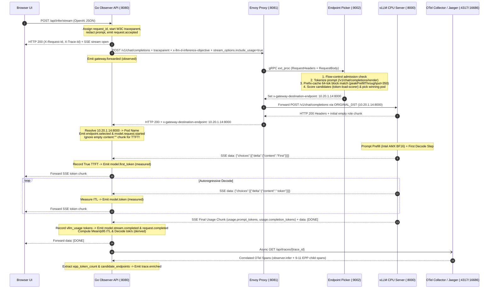
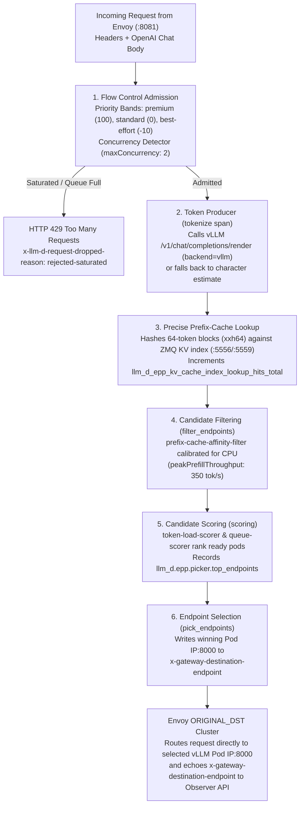

# Architecture: llm-d Inference Observatory

## 1. Architectural Mission

`llm-d-inference-observatory` is an interactive observability and educational platform that connects real OpenAI-compatible inference requests to real backend lifecycle events on CPU-only Google Kubernetes Engine (GKE), paired with a deterministic local simulator (`OBSERVER_MOCK_MODE=true`).

It is engineered around three strict architectural separations:

1. **Inference Data Path (Synchronous Request & Token Stream)** — `Browser UI → Go Observer API (:8080) → Envoy Proxy (:8081) ↔ Endpoint Picker (:9002) → InferencePool → vLLM CPU Model Server (:8000) → Observer API → Browser UI`.
2. **Parallel Observability Pipeline (Out-of-Band Telemetry)** — Live SSE lifecycle event stream (`GET /api/requests/{id}/events`), OpenTelemetry span export (`Observer API & EPP → OTel Collector (:4317) → Jaeger (:16686)`), and Prometheus metric scraping (`EPP :9090/metrics` and `vLLM :8000/metrics`).
3. **Kubernetes Control Plane (Asynchronous Watchers Only)** — `kube-apiserver` reconciles `InferencePool`, `InferenceObjective`, and `Pod` readiness. **A normal LLM inference request never traverses `kube-apiserver`.**

---

## 2. End-to-End Request Lifecycle Sequence

---

## 3. Endpoint Picker (EPP) Filtering, Scoring & Routing Pipeline

Inside the `llm-d-router-epp` pod, Envoy pauses routing during request headers and body processing and invokes EPP over localhost gRPC `ext_proc` (`127.0.0.1:9002`):

### Actual Selected Endpoint vs. Ranked Candidates
- **Actual Selected Endpoint (`selected_endpoint`):** Determined exclusively from the authoritative `x-gateway-destination-endpoint` header (`<pod_ip>:8000`) set by EPP and echoed by Envoy on the scheduled route (`original_destination_cluster`), or from an explicit `selected_endpoint` span attribute. The Observer API resolves `<pod_ip>:8000` against the headless service DNS (`llm-d-router-epp-model-servers`) to display `llm-d-observatory/<pod_name> (<pod_ip>:8000)`.
- **Ranked Candidates (`candidate_endpoints`):** Extracted from the `pick_endpoints` span attribute `llm_d.epp.picker.top_endpoints` and displayed separately for educational inspection. **The Observatory never infers the winning endpoint from candidate rankings.**

---

## 4. Component Responsibilities & Provenance

### 4.1 Gateway API & Envoy Routing Proxy (`gateway-proxy`)
- **Artifact:** `docker.io/envoyproxy/envoy:distroless-v1.33.2` (rendered by `oci://ghcr.io/llm-d/charts/llm-d-router-standalone:v1.0.0`).
- **Role:** Terminates incoming OpenAI HTTP requests on port `8081` (exposed via ClusterIP Service port `80`). Executes an `early_header_mutation` extension to strip any client-provided `x-gateway-destination-endpoint` header, preventing external callers from spoofing backend pod selection.
- **Echoed Routing Metadata:** Echoes `%REQ(X-GATEWAY-DESTINATION-ENDPOINT)%` in response headers on the scheduled route (`original_destination_cluster`) so downstream observability tools can verify the exact pod IP chosen by EPP.
- **Fail-Open Resiliency:** Configured with `failureMode: FailOpen` (`failure_mode_allow: true`); if EPP is unreachable, Envoy falls back to the `inference_pool_fallback` cluster (`STRICT_DNS` over `llm-d-router-epp-model-servers:8000` with `LEAST_REQUEST`).

### 4.2 Endpoint Picker (`epp`)
- **Artifact:** `ghcr.io/llm-d/llm-d-router-endpoint-picker:v1.0.0`.
- **Role:** Stateful gRPC external processor listening on `127.0.0.1:9002` (health on `:9003`, RBAC-protected Prometheus metrics on `:9090/metrics`).
- **Supported Profiles in `deploy/llm-d/`:**
  1. `optimized-baseline`: Combines `featureGates: [flowControl]`, `concurrency-detector`, `token-producer` (`/v1/*/render`), `precise-prefix-cache-producer` (`enableMetrics: true`, `blockSizeTokens: 64`, ZMQ `:5556`/`:5559`), `prefix-cache-affinity-filter` (`peakPrefillThroughput: 350`), and `token-load-scorer`.
  2. `precise-prefix-cache`: Dedicated overlay focusing on ZMQ KV-block event indexing (`xxh64`, `64`-token blocks) and `vllm` render tokenization.
  3. `flow-control`: Dedicated overlay focusing on priority-band admission queues (`100` premium, `0` standard, `-10` best-effort) with `round-robin-fairness-policy` and `fcfs-ordering-policy`.

### 4.3 InferencePool & InferenceObjective (`inference-pool`)
- **CRDs:** `InferencePool` (`inference.networking.k8s.io/v1` from GAIE `v1.6.2`) and `InferenceObjective` (`inference.networking.x-k8s.io/v1alpha2`).
- **Role:** Declares which model-server pods belong to the pool (`matchLabels: { llm-d.ai/guide: optimized-baseline }`, target port `8000`) and defines priority-band objectives (`premium-traffic`, `standard-traffic`, `best-effort-traffic`).

### 4.4 vLLM CPU Model Server (`model-server`)
- **Artifact:** `docker.io/vllm/vllm-openai-cpu:v0.31.0` (vLLM `0.17.1`).
- **Model:** `Qwen/Qwen2.5-0.5B-Instruct` (BF16, ungated, `2` replicas on `c3-standard-22` Intel Sapphire Rapids with hardware AMX `amx_bf16`, `VLLM_CPU_KVCACHE_SPACE=4`, `--enable-prefix-caching`, `--block-size=64`).
- **Observability Hooks:** Exposes `/metrics` on `:8000` and publishes real-time KV cache block events over ZMQ (`tcp://*:5556` PUB, `tcp://*:5559` ROUTER replay).

### 4.5 Go Observer API (`observer-api`)
- **Source:** [`backend/observer/`](./backend/observer/).
- **Role:** Accepts browser/CLI requests on `:8080`, enforces security boundaries (SSRF host allowlist, model allowlist, request body byte limit, max output tokens, concurrency semaphore, prompt/secret redaction), injects `"stream_options": {"include_usage": true}`, forwards traffic to `llm-d`, measures monotonic timings, streams SSE lifecycle events, scrapes EPP/vLLM Prometheus metrics across all pod IPs, and enriches traces asynchronously from Jaeger.

### 4.6 React 19 Observatory UI (`observatory-frontend`)
- **Source:** [`frontend/`](./frontend/).
- **Role:** Five-screen interactive application featuring the **Interactive Topology** canvas (`@xyflow/react`), **Inference Playground**, **Live Lifecycle Timeline**, **Metrics & Counter Reconciliation**, and **13-Module Learning Lab**.

---

## 5. Observation Classifications & Honesty Rules

Every stage, timing, and metric in the Observatory is explicitly classified:

| Classification | Meaning | Example |
| :--- | :--- | :--- |
| `observed` | Directly observed from a real backend event, HTTP response header, or OpenTelemetry span. | `gateway.forwarded`, `endpoint.selected` (`x-gateway-destination-endpoint`), `trace.enriched` |
| `measured` | Directly timed by the Observer API using monotonic clocks. | `UpstreamHeadersMs`, `TTFTMs` (True TTFT), `TotalDurationMs` |
| `derived` | Calculated deterministically from measured values under a documented formula. | `MeanITLMs`, `P95ITLMs`, `DecodeTokensPerSec`, `EndToEndTokensPerSec` |
| `aggregate` | System-wide counter or gauge scraped over a time window; never attributed to a single request. | `llm_d_epp_flow_control_queue_size`, `vllm:num_requests_waiting` |
| `unavailable` | Not exposed by the current stack configuration without fabricating data. | `PrefillDurationMs` when no dedicated model-server prefill span is exported |
| `simulated` | Generated by the deterministic local mock simulator (`OBSERVER_MOCK_MODE=true`). | All events, timings, and spans in local demo mode |
