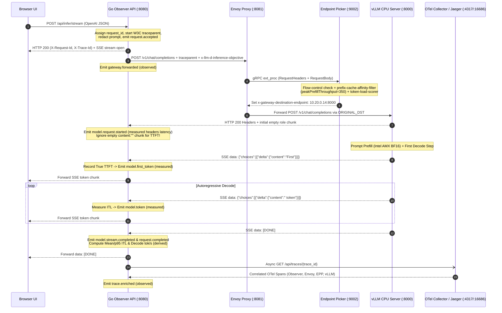

# Architecture: llm-d Inference Observatory

## 1. Architectural Mission

`llm-d-inference-observatory` is an interactive observability and educational environment that connects real OpenAI-compatible inference requests to real backend lifecycle events on CPU-only Google Kubernetes Engine (GKE).

It is designed around three strict architectural separations:

1. **Inference Data Path** — The synchronous HTTP/SSE request and token stream (`Browser → Observer API → Envoy Proxy → EPP ext_proc → vLLM CPU Model Server → Observer API → Browser`).
2. **Parallel Observability Pipeline** — Out-of-band SSE lifecycle event emission, OpenTelemetry span collection (`OTel Collector → Jaeger`), and Prometheus/GMP metric scraping (`:9090` and `:8000`).
3. **Kubernetes Control Plane** — Asynchronous CRD and Pod reconciliation (`kube-apiserver` watching `InferencePool`, `InferenceObjective`, and `Pod` endpoints). **A normal LLM inference request never passes through the Kubernetes API server.**

---

## 2. End-to-End Sequence Diagram

---

## 3. Component Roles & Provenance

### 3.1 Gateway API & Envoy Routing Proxy (`gateway-proxy`)
- **Artifact:** `docker.io/envoyproxy/envoy:distroless-v1.33.2` (rendered by `oci://ghcr.io/llm-d/charts/llm-d-router-standalone:v1.0.0`).
- **Role:** Terminates incoming OpenAI HTTP requests on port `8081` (exposed via ClusterIP Service port `80`). Executes an `early_header_mutation` extension to strip any client-provided `x-gateway-destination-endpoint` header, preventing external callers from bypassing EPP scheduling.
- **Fail-Open Resiliency:** If EPP is unreachable, Envoy falls back to the `inference_pool_fallback` cluster (`STRICT_DNS` over `llm-d-router-epp-model-servers:8000` with `LEAST_REQUEST`).

### 3.2 Endpoint Picker (`epp`)
- **Artifact:** `ghcr.io/llm-d/llm-d-router-endpoint-picker:v1.0.0`.
- **Role:** Stateful gRPC external processor listening on `127.0.0.1:9002` (health on `:9003`, RBAC-protected Prometheus metrics on `:9090/metrics`).
- **Supported Profiles in `deploy/llm-d/`:**
  1. `optimized-baseline`: `approx-prefix-cache-producer` + `inflight-load-producer` + `prefix-cache-affinity-filter` (`peakPrefillThroughput: 350`) + `token-load-scorer`.
  2. `precise-prefix-cache`: Adds `token-producer` (`/v1/*/render`), `endpoint-notification-source`, and ZMQ `precise-prefix-cache-producer` (`blockSizeTokens: 64`, `hashAlgorithm: xxh64`, `:5556` PUB / `:5559` replay).
  3. `flow-control`: Enables `featureGates: [flowControl]`, `concurrency-detector` (`maxConcurrency: 2`), and priority bands (`100` premium, `0` standard, `-10` best-effort) with `round-robin-fairness-policy` and `fcfs-ordering-policy`.

### 3.3 InferencePool & InferenceObjective (`inference-pool`)
- **CRDs:** `InferencePool` (`inference.networking.k8s.io/v1` from GAIE `v1.6.2`) and `InferenceObjective` (`llm-d.ai/v1` from `llm-d` `v1.0.0`).
- **Role:** Declares which model-server pods belong to the pool (`matchLabels: { llm-d.ai/guide: optimized-baseline }`, port `8000`) and defines priority-band objectives (`premium-traffic`, `standard-traffic`, `best-effort-traffic`).

### 3.4 vLLM CPU Model Server (`model-server`)
- **Artifact:** `docker.io/vllm/vllm-openai-cpu:v0.31.0`.
- **Model:** `Qwen/Qwen2.5-0.5B-Instruct` (BF16, ungated, `2` replicas on `c3-standard-22` Intel Sapphire Rapids with hardware AMX `amx_bf16`, `VLLM_CPU_KVCACHE_SPACE=4`, `--enable-prefix-caching`, `--block-size=64`).
- **Observability Hooks:** Exposes `/metrics` on `:8000`, ZMQ KV events on `:5556`/`:5559`, and OTLP trace spans via `--otlp-traces-endpoint=grpc://otel-collector.llm-d-observatory.svc.cluster.local:4317`.

### 3.5 Go Observer API (`observer-api`)
- **Source:** `backend/observer/`.
- **Role:** Accepts browser/CLI requests on `:8080`, enforces security boundaries (upstream host allowlist, model allowlist, request body byte limit, max output tokens, concurrency semaphore, prompt/secret redaction), forwards traffic to `llm-d`, measures monotonic timings, streams SSE lifecycle events, and enriches traces asynchronously from Jaeger.

---

## 4. Observation Classifications & Honesty Rules

Every stage, timing, and metric in the Observatory is explicitly classified:

| Classification | Meaning | Example |
| :--- | :--- | :--- |
| `observed` | Directly observed from a real backend event, HTTP response header, or OpenTelemetry span. | `gateway.forwarded`, `trace.enriched`, HTTP `429` `x-llm-d-request-dropped-reason` |
| `measured` | Directly timed by the Observer API using monotonic clocks. | `UpstreamHeadersMs`, `TTFTMs` (True TTFT), `TotalDurationMs` |
| `derived` | Calculated deterministically from measured values under a documented formula. | `MeanITLMs`, `P95ITLMs`, `DecodeTokensPerSec`, `EndToEndTokensPerSec` |
| `aggregate` | System-wide counter or gauge scraped over a time window; never attributed to a single request. | `llm_d_epp_flow_control_queue_size`, `vllm:num_requests_waiting` |
| `unavailable` | Not exposed by the current stack configuration without fabricating data. | `PrefillDurationMs` when no dedicated model-server prefill span is exported |
| `simulated` | Generated by the deterministic local mock simulator (`OBSERVER_MOCK_MODE=true`). | All events, timings, and spans in local demo mode |
