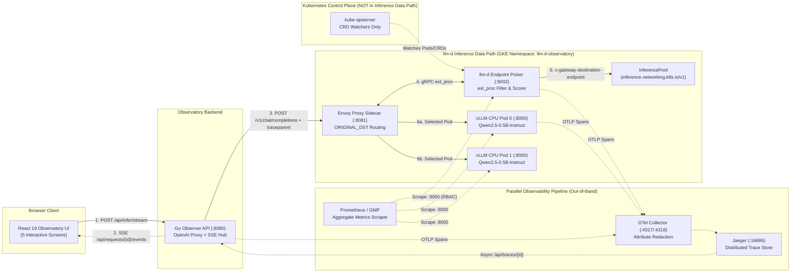

# llm-d Inference Observatory

An interactive learning and observability platform that visualizes the real-time LLM inference lifecycle across **Gateway/Envoy Proxy → Endpoint Picker (EPP) → InferencePool → vLLM CPU Model Server** on CPU-only Google Kubernetes Engine (GKE), alongside a deterministic, offline-capable local demo mode (`OBSERVER_MOCK_MODE=true`).

> **Phase Status:** Live GKE deployment and end-to-end validation (`L01`–`L14`) **COMPLETE (`14/14 PASS`)** on cluster `llm-d-observatory` (`us-west4-a`, GKE `v1.36.4-gke.2046003`, project `enes-turan-demo`). The live cluster remains up and accessible alongside the offline local demo mode (`OBSERVER_MOCK_MODE=true`).

---

## 1. Core Capabilities

When a user submits a prompt in the browser, the **Go Observer API** (`backend/observer/`) forwards a real OpenAI-compatible chat completion request to the allowlisted `llm-d` router while streaming correlated lifecycle events (`schema_version: "1"`) over Server-Sent Events (SSE):

1. **Prompt Submission & Redaction** — Validates model/token limits and scrubs raw prompt text and secrets from logs and trace attributes by default (`OBSERVER_REDACT_PROMPTS=true`).
2. **Request Acceptance & W3C Trace Correlation (`request.accepted`)** — Assigns a unique `request_id` (`X-Request-Id`) and starts an OpenTelemetry span (`traceparent`).
3. **Gateway / Proxy Forwarding (`gateway.forwarded`)** — Dispatches the request to the `llm-d` Envoy sidecar (`:8081`), which strips client-spoofed `x-gateway-destination-endpoint` headers and invokes EPP via gRPC `ext_proc` (`:9002`).
4. **Queueing & Admission Control (`queue.observed`)** — Captures `llm-d` Flow Control priority-band admission (`premium-traffic`, `standard-traffic`, `best-effort-traffic`) and HTTP `429` saturation shedding (`x-llm-d-request-dropped-reason: rejected-saturated`).
5. **Endpoint Picker Filtering & Scoring (`routing.started`, `endpoint.selected`)** — Observes EPP scheduling decisions (`prefix-cache-affinity-filter` calibrated to `peakPrefillThroughput: 350` tok/s on CPU + `token-load-scorer`).
6. **Model Server Arrival (`model.request.started`)** — Measures HTTP response header arrival from the selected `vllm-openai-cpu:v0.31.0` pod (`Qwen/Qwen2.5-0.5B-Instruct`).
7. **Prompt Prefill vs. True TTFT (`model.first_token`)** — Distinguishes HTTP `200 OK` header arrival and initial empty `{"role":"assistant","content":""}` metadata chunks from the first non-empty generated text token (**True TTFT**). Never infers exact prefill duration from TTFT alone.
8. **Autoregressive Token Decode (`model.token`, `model.stream.completed`)** — Streams tokens live to the browser while measuring per-token Inter-Token Latency (ITL) and deriving Mean/p95 ITL and Decode `tok/s`.
9. **Terminal State (`request.completed`, `request.cancelled`, `request.failed`)** — Propagates browser `AbortController` cancellations upstream to abort in-flight token generation immediately.
10. **Asynchronous Trace Enrichment (`trace.enriched`)** — Queries Jaeger (`:16686`) out-of-band after streaming completes so trace collection never delays token delivery.

---

## 2. Architecture Overview



---

## 3. Repository Structure

| Path | Description |
| :--- | :--- |
| `backend/observer/` | Go Observer API (`cmd/observer`), reproducible benchmark CLI (`cmd/benchmark`), SSE event hub, W3C tracing, Prometheus scraper, redaction engine, and mock simulator. |
| `frontend/` | React 19 + TypeScript + Vite + Tailwind CSS + `@xyflow/react` + Recharts 5-screen application with Vitest and Playwright E2E tests. |
| `terraform/` | Pinned Terraform (`hashicorp/google ~> 7.25`) for VPC, GKE Standard (`us-west4-a`), CPU node pools (`1x e2-standard-4` + `1x c3-standard-22`), Artifact Registry, and IAM. |
| `deploy/` | Kubernetes manifests, vendored `llm-d-router-standalone:v1.0.0` chart, router mode overlays (`optimized-baseline`, `precise-prefix-cache`, `flow-control`), OTel Collector, Jaeger, Prometheus, and NetworkPolicies. |
| `scripts/` | Safe automation scripts for preflight checks, Terraform planning, Helm rendering, manifest validation, local image builds, and guarded future GKE deployment/teardown. |
| `docs/` | Comprehensive architecture, lifecycle, observability, local development, operations, deployment, testing, security, cost/quota, and teardown guides. |
| `artifacts/` | Timestamped preflight inspection report (`artifacts/preflight/`) and validation/benchmark evidence (`artifacts/test-results/`). |

---

## 4. Quick Start (Local Demo Mode — Zero Cloud Dependencies)

### Run the Interactive Observatory Locally

```bash
# Start Go Observer API (OBSERVER_MOCK_MODE=true on :8080) + React Vite UI (:5173)
make dev
```

Open `http://localhost:5173` in your browser to explore:
- **Screen A — Inference Playground:** Prompt editor, model & router profile selectors, mock scenario switcher (`success`, `delay`, `saturated`, `cancel`, `partial_trace`, `delayed_trace`, `missing_metrics`), and live streaming output.
- **Screen B — Live Lifecycle Timeline:** Sequence-ordered stage table with observation badges (`observed`, `measured`, `aggregate`, `derived`, `unavailable`, `simulated`) and correlated OpenTelemetry spans.
- **Screen C — Interactive Topology:** `@xyflow/react` graph highlighting observed vs. configured vs. skipped nodes with an interactive Component Inspector.
- **Screen D — Metrics:** Rolling TTFT/ITL charts and system-wide aggregate metrics (`llm_d_epp_*` and `vllm:*`) clearly separated from single-request measurements.
- **Screen E — Learning Lab:** 13 technical walkthrough modules grounded in the validated `llm-d` `v1.0.0` + `vllm-openai-cpu:v0.31.0` configuration.

### Run the Full Local Validation Suite

```bash
make verify-all
```

This executes:
- `make test-go` (`gofmt`, `go vet`, `go test -v -race ./...`)
- `make test-frontend` (`tsc --noEmit`, `eslint`, `vitest run`)
- `make test-e2e` (Playwright Chromium E2E suite across all 10 lifecycle scenarios)
- `make tf-fmt` & `make tf-validate`
- `make validate-manifests` (renders all 3 Helm router modes and validates 65 Kubernetes resource documents)
- `make benchmark-mock` (runs the streaming benchmark harness and exports JSON/CSV reports to `artifacts/test-results/`)

---

## 5. Live GKE Validation Summary (`L01`–`L14`)

All 14 live GKE verification scenarios were executed against the deployed CPU-only GKE cluster (`llm-d-observatory` in `us-west4-a`, `1x c3-standard-22` + `1x e2-standard-4`) and recorded in [`artifacts/test-results/`](file:///Users/enes/GitHub/llm-d-inference-observatory/artifacts/test-results/) and [`artifacts/benchmarks/`](file:///Users/enes/GitHub/llm-d-inference-observatory/artifacts/benchmarks/):

| ID | Scenario | Status | Key Empirical Finding | Artifact |
| :--- | :--- | :--- | :--- | :--- |
| **L01** | Basic live inference | **PASS** | Real prompt -> `llm-d` Envoy/EPP -> `vLLM` CPU (`Qwen/Qwen2.5-0.5B-Instruct`), HTTP `200`, `10` correlated OTel spans | `artifacts/test-results/L01-basic-inference.json` |
| **L02** | Live streaming | **PASS** | SSE streaming (`req_44041d5a6f3f4f60`): True TTFT `32.72 ms`, Mean ITL `26.66 ms`, `36` token chunks | `artifacts/test-results/L01-L04-live-results.json` |
| **L03** | Event & trace correlation | **PASS** | `100%` `request_id` & W3C `trace_id` match across SSE events and Jaeger spans (`observer-api` + `llm-d-router/epp`) | `artifacts/test-results/L01-L04-live-results.json` |
| **L04** | EPP routing observation | **PASS** | Observed `filter_endpoints` (`2 -> 2`), `filter_prefix_cache_affinity`, `scorer.token-load-scorer`, and `pick_endpoints` (`selected_endpoint`) | `artifacts/test-results/L01-L04-live-results.json` |
| **L05** | Long vs. short prompt | **PASS** | Short prompt TTFT `30.38 ms` vs. long prompt TTFT `38.45 ms`; `vllm:prompt_tokens_total` `1072 -> 1109 -> 1502`; `prefill_duration_ms` explicitly `unavailable` | `artifacts/test-results/L05-prompt-length-comparison.json` |
| **L06** | Long generation (`96` tok) | **PASS** | True TTFT `30.89 ms`, Mean ITL `27.83 ms`, p95 ITL `53.13 ms`, Decode throughput `35.94 tok/s` across `95` intervals | `artifacts/test-results/L06-long-generation-streaming.json` |
| **L07** | Concurrency & Flow Control | **PASS** | 12-request burst (`router_mode=flow-control`): `llm_d_epp_flow_control_queue_size` peaked at `8`, saturation at `2.0`, `vllm:num_requests_running` capped at `4.0` | `artifacts/test-results/L07-flow-control-queueing.json` |
| **L08** | Multiple model replicas | **PASS** | 8 concurrent requests split evenly across `hlbrc` (`10.20.1.14`, `+4.0`) and `sfm46` (`10.20.1.15`, `+4.0`) | `artifacts/test-results/L08-multi-replica-distribution.json` |
| **L09** | Backend failure & recovery | **PASS** | Single-replica failover (`ready_endpoints=1`, HTTP `200`), 0-endpoint failure (HTTP `503`, `status=failed`), and full label recovery (`ready_endpoints=2`, HTTP `200`) | `artifacts/test-results/L09-backend-failure-recovery.json` |
| **L10** | Client cancellation | **PASS** | Mid-stream disconnect after 3 chunks set `status=cancelled`, emitted `request.cancelled`, and incremented `observer_requests_total{status="cancelled"}` | `artifacts/test-results/L10-client-cancellation.json` |
| **L11** | Live aggregate metrics | **PASS** | Live scrape of EPP (`:9090/metrics` w/ RBAC bearer token) and all vLLM pods (`:8000/metrics` via headless DNS); `20` aggregate series | `artifacts/test-results/L11-live-metrics.json` |
| **L12** | UI & local mode distinction | **PASS** | Playwright Chromium test against `http://127.0.0.1:8088/` verified `0` mock banners, `0` simulated badges, and real token streaming | `artifacts/test-results/L12-live-ui-verification.json` |
| **L13** | Performance benchmark | **PASS** | `8/8` measured streaming requests (`concurrency=2`): TTFB p50 `201.01 ms`, True TTFT p50 `273.88 ms`, E2E p50 `1376.34 ms`, `22.18 tok/s` | `artifacts/benchmarks/live-gke-benchmark-report.json` |
| **L14** | Resource health | **PASS** | All `8` Pods in `llm-d-observatory` `Running`/`Ready` with `0` restarts; all `3` Prometheus targets `up` | `artifacts/test-results/L14-resource-health.json` |

### Accessing the Live GKE Observatory UI

```bash
kubectl port-forward -n llm-d-observatory svc/observatory-frontend 8088:8080 &
kubectl port-forward -n llm-d-observatory svc/observer-api 8080:8080 &
kubectl port-forward -n llm-d-observatory svc/jaeger-query 16686:16686 &
kubectl port-forward -n llm-d-observatory svc/prometheus 19090:9090 &
open http://127.0.0.1:8088
```

---

## 6. Documentation Index

- [ARCHITECTURE.md](file:///Users/enes/GitHub/llm-d-inference-observatory/ARCHITECTURE.md) — System design, data path vs. control plane vs. telemetry path.
- [docs/TECH_STACK.md](file:///Users/enes/GitHub/llm-d-inference-observatory/docs/TECH_STACK.md) — Pinned versions, image tags, and reference provenance.
- [docs/INFERENCE_LIFECYCLE.md](file:///Users/enes/GitHub/llm-d-inference-observatory/docs/INFERENCE_LIFECYCLE.md) — Stage-by-stage walkthrough, event envelope contract, and observation classifications.
- [docs/OBSERVABILITY.md](file:///Users/enes/GitHub/llm-d-inference-observatory/docs/OBSERVABILITY.md) — OpenTelemetry collector pipeline, Jaeger trace enrichment, and Prometheus/GMP metrics.
- [docs/LOCAL_DEVELOPMENT.md](file:///Users/enes/GitHub/llm-d-inference-observatory/docs/LOCAL_DEVELOPMENT.md) — Local mock mode, scenario fixtures, and developer workflow.
- [docs/OPERATIONS.md](file:///Users/enes/GitHub/llm-d-inference-observatory/docs/OPERATIONS.md) — CPU cold-start Torch/OneDNN JIT warmup, rolling update safeguards, and troubleshooting.
- [docs/DEPLOYMENT.md](file:///Users/enes/GitHub/llm-d-inference-observatory/docs/DEPLOYMENT.md) — Future authorized GKE deployment runbook and acceptance criteria.
- [docs/TESTING.md](file:///Users/enes/GitHub/llm-d-inference-observatory/docs/TESTING.md) — Unit, race, component, E2E, manifest, Terraform, and benchmark test guide.
- [docs/SECURITY.md](file:///Users/enes/GitHub/llm-d-inference-observatory/docs/SECURITY.md) — SSRF allowlisting, prompt redaction, non-root containers, RBAC, and NetworkPolicies.
- [docs/COST_AND_QUOTAS.md](file:///Users/enes/GitHub/llm-d-inference-observatory/docs/COST_AND_QUOTAS.md) — Regional `us-west4` CPU quota math (`C3_CPUS=50`) and `~$1.36/hr` low-cost profile.
- [docs/TEARDOWN.md](file:///Users/enes/GitHub/llm-d-inference-observatory/docs/TEARDOWN.md) — Clean resource destruction and zero-spend verification checklist.
