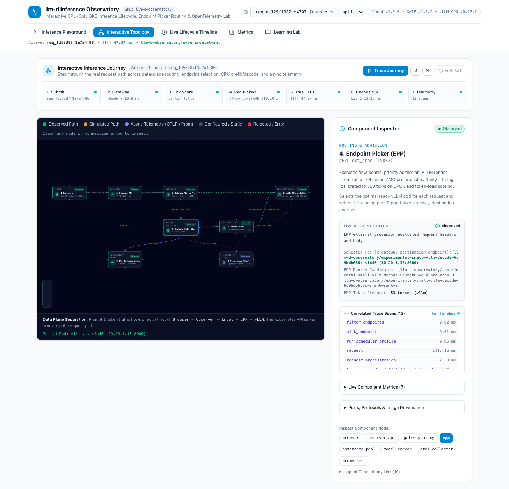
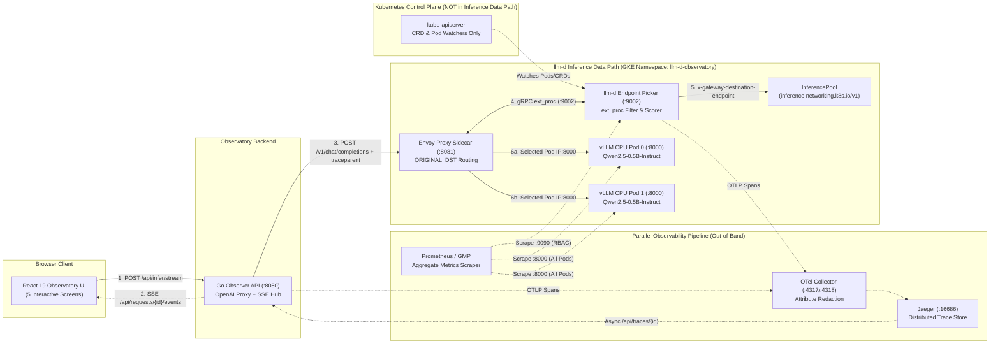
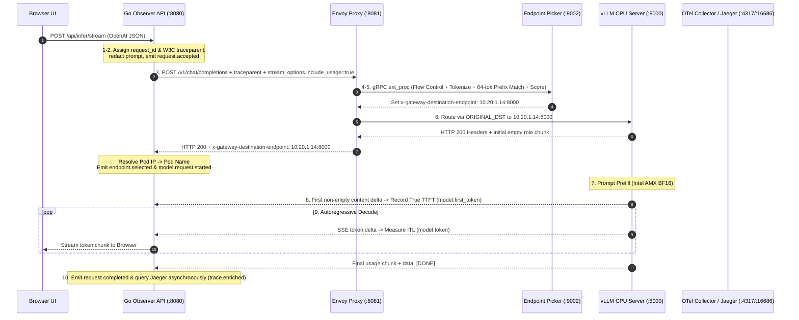
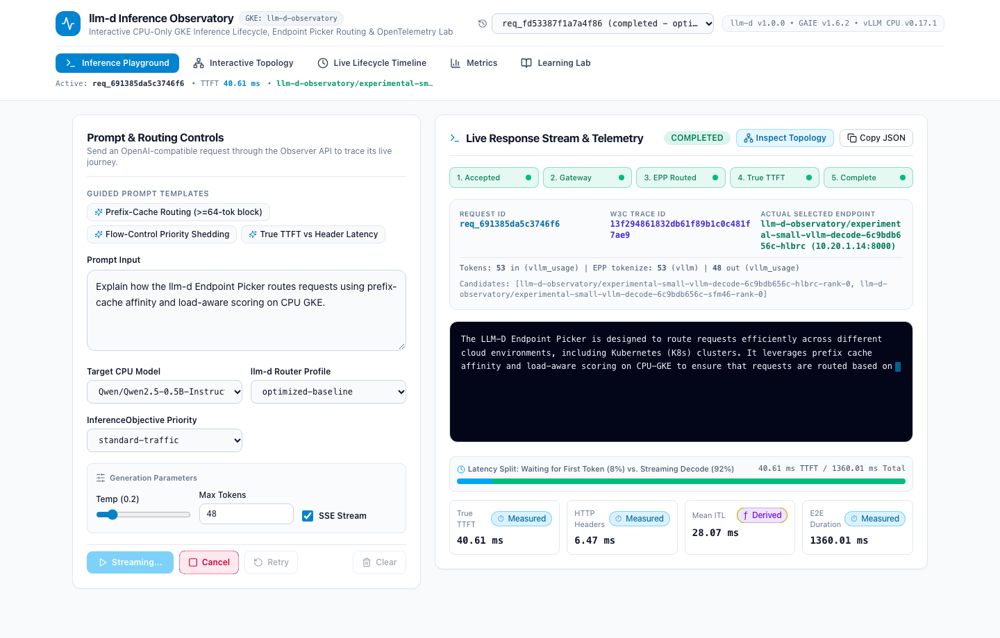
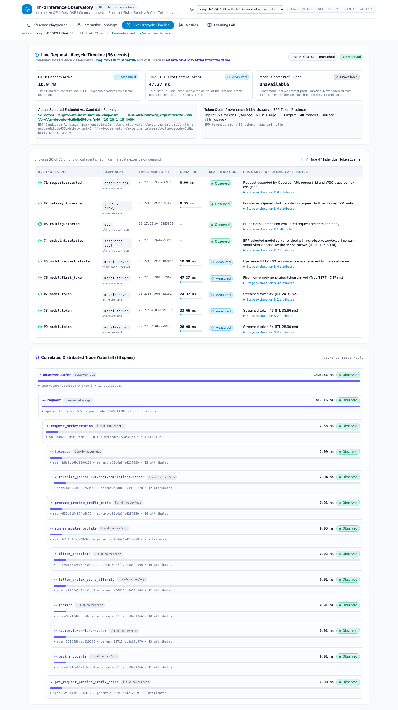
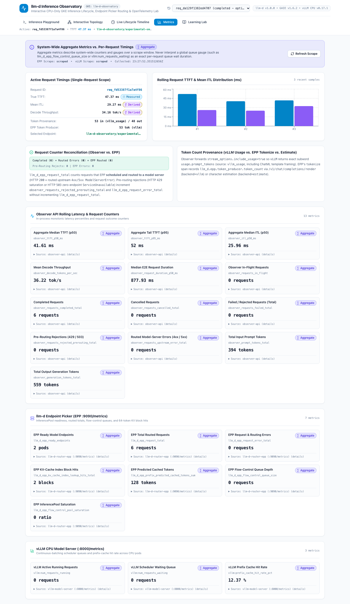
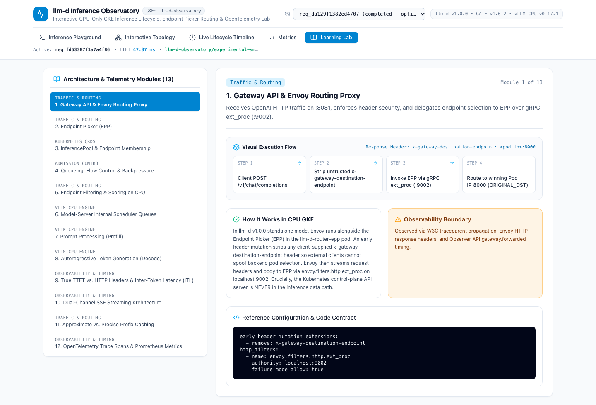

<div align="center">

# `llm-d-inference-observatory`

**Real-Time Observability & Educational Platform for the `llm-d` & `vLLM` CPU Inference Lifecycle on GKE**

[-326CE5?logo=kubernetes&logoColor=white)](https://cloud.google.com/kubernetes-engine)
[](https://gateway-api-inference-extension.sigs.k8s.io/)
[](deploy/versions.env)
[-06B6D4)](deploy/versions.env)
[](backend/observer/go.mod)
[](frontend/package.json)
[](deploy/telemetry)
[](terraform/versions.tf)
[](LICENSE)

[**Overview**](#1-overview--key-capabilities) •
[**Architecture**](#2-system-architecture) •
[**Request Lifecycle**](#3-inference-request-lifecycle) •
[**UI Screens**](#4-interactive-screens--live-gke-screenshots) •
[**Local Quickstart**](#7-installation--local-development) •
[**GKE Deployment**](#9-gke-deployment-using-terraform) •
[**Live Verification**](#10-testing--verification-commands) •
[**Docs**](#12-documentation-index)

</div>

---

An interactive observability and educational platform that visualizes the real-time LLM inference lifecycle across `Browser → Observer API → Gateway/Envoy → Endpoint Picker (EPP) → InferencePool → vLLM CPU Model Server` on CPU-only Google Kubernetes Engine (GKE), paired with a deterministic, zero-cloud local simulator (`OBSERVER_MOCK_MODE=true`).



> [!TIP]
> **Two Operating Modes (Local Mock Simulator & Live GKE):**
> - **Local Simulator Mode (`$0.00/hr`)**: Run `make dev` or `docker compose up --build` locally with zero cloud dependencies (`OBSERVER_MOCK_MODE=true`).
> - **Live GKE Mode**: Provision the CPU-only GKE cluster (`c3-standard-22` Intel Sapphire Rapids AMX + `e2-standard-4`) via Terraform ([Section 9 — GKE Deployment Using Terraform](#9-gke-deployment-using-terraform)). All 14 live verification scenarios (`L01`–`L14`) are captured in [`artifacts/test-results/`](artifacts/test-results/).

---

## Table of Contents

1. [Overview & Key Capabilities](#1-overview--key-capabilities)
2. [System Architecture](#2-system-architecture)
3. [Inference Request Lifecycle](#3-inference-request-lifecycle)
4. [Interactive Screens & Live GKE Screenshots](#4-interactive-screens--live-gke-screenshots)
5. [Technology Stack & Supported Environment](#5-technology-stack--supported-environment)
6. [Prerequisites](#6-prerequisites)
7. [Installation & Local Development](#7-installation--local-development)
8. [Usage Examples & Launch Instructions](#8-usage-examples--launch-instructions)
9. [GKE Deployment Using Terraform](#9-gke-deployment-using-terraform)
10. [Testing & Verification Commands](#10-testing--verification-commands)
11. [Observability, Telemetry Integrity & Troubleshooting](#11-observability-telemetry-integrity--troubleshooting)
12. [Documentation Index](#12-documentation-index)
13. [Cleanup & Resource Teardown](#13-cleanup--resource-teardown)
14. [Known Limitations](#14-known-limitations)
15. [License](#15-license)

---

## 1. Overview & Key Capabilities

`llm-d-inference-observatory` is **not** another chatbot wrapper or static architecture diagram. When a user submits a prompt in the browser, the **Go Observer API** ([`backend/observer/`](backend/observer/)) sends a real OpenAI-compatible chat completion request through the `llm-d` inference routing path while streaming correlated lifecycle events (`schema_version: "1"`), OpenTelemetry spans, and Prometheus metrics to the UI in real time:

- **Interactive Architecture Topology (`@xyflow/react`)** — Step-by-step request journey playback (`Submit → Gateway → EPP Score → Pod Picked → True TTFT → Decode SSE → Telemetry`) with dual **Component Inspector** and **Connection Inspector** panels.
- **Authoritative Endpoint Selection Visibility** — Captures the exact winning pod (`x-gateway-destination-endpoint: <pod_ip>:8000`) selected by EPP and echoed by Envoy (`ORIGINAL_DST`), keeping it strictly separate from EPP's ranked candidate list (`llm_d.epp.picker.top_endpoints`).
- **True TTFT vs. HTTP Header Arrival** — Distinguishes HTTP `200 OK` header latency and initial empty `{"role":"assistant","content":""}` chunks from the first non-empty generated text token (**True TTFT**). Never fabricates model-server prefill duration from TTFT alone.
- **Explicit Token & Counter Provenance** — Reconciles Observer vs. EPP request counters (`Completed + Routed Errors = EPP Routed`) and compares vLLM's exact subword usage (`stream_options.include_usage=true`) against EPP's `/v1/chat/completions/render` tokenization (`backend=vllm`).
- **Out-of-Band Trace Enrichment** — Queries Jaeger (`:16686`) asynchronously after token streaming finishes (`trace.enriched`) so observability never adds latency to the inference path.
- **Strict Observation Honesty** — Classifies every event, timing, and metric as `observed`, `measured`, `derived`, `aggregate`, `unavailable`, or `simulated`.

---

## 2. System Architecture

The platform enforces a strict separation between the **synchronous inference data path**, the **parallel out-of-band observability pipeline**, and the **Kubernetes control plane** (which watches CRDs/Pods asynchronously and is never in the request path):



---

## 3. Inference Request Lifecycle

Every inference request progresses through 10 observable stages defined in [`docs/INFERENCE_LIFECYCLE.md`](docs/INFERENCE_LIFECYCLE.md):



---

## 4. Interactive Screens & Live GKE Screenshots

### 4.1 Interactive Topology (`ScreenTopology.tsx`)
Provides a 7-stage **Interactive Inference Journey** walkthrough with playback controls (`Trace Journey / Pause`, `Previous`, `Next`, `Full Path`), a custom React Flow canvas separating data-plane routing from async telemetry links, and dual **Component** / **Connection** inspectors.


### 4.2 Inference Playground (`ScreenPlayground.tsx`)
Includes one-click guided prompt templates (`Prefix-Cache Routing (>=64-tok block)`, `Flow-Control Priority Shedding`, `True TTFT vs Header Latency`), router profile & `InferenceObjective` priority selectors, a 5-stage live progress strip, streamed token output, and a visual **TTFT vs. Streaming Decode Latency Split** bar.



### 4.3 Live Lifecycle Timeline & Trace Waterfall (`ScreenTimeline.tsx`)
Displays sequence-ordered SSE lifecycle events with proportional latency bars, actual selected endpoint vs. candidate rankings, token provenance (`vllm_usage` vs. EPP `tokenize`), and a hierarchical parent-child **Correlated Distributed Trace Waterfall**.



### 4.4 Metrics & Counter Reconciliation (`ScreenMetrics.tsx`)
Separates single-request timings from system-wide aggregate Prometheus gauges (`llm_d_epp_*` and `vllm:*`), with a live **Request Counter Reconciliation** equation badge (`Completed + Routed Errors = EPP Routed`).



### 4.5 13-Module Architecture Learning Lab (`ScreenLearningLab.tsx`)
Interactive technical modules with 4-step **Visual Execution Flows**, **Key Telemetry Signals**, **How It Works in CPU GKE**, **Observability Boundaries**, and reference configuration snippets.



---

## 5. Technology Stack & Supported Environment

| Layer | Component | Pinned Version / Artifact |
| :--- | :--- | :--- |
| **GKE Cluster** | GKE Standard (Zonal CPU-Only, `us-west4-a`) | `REGULAR` channel (`v1.36.4-gke.2046003` verified) |
| **CPU Inference Node** | Intel Xeon Sapphire Rapids (`c3-standard-22`) | `22 vCPU`, `88 GB DDR5`, hardware AMX (`amx_bf16`) |
| **System / Telemetry Node** | `e2-standard-4` | `4 vCPU`, `16 GB RAM` |
| **Gateway API CRDs** | Gateway API Inference Extension (GAIE) | `v1.6.2` (`inference.networking.k8s.io/v1`) |
| **Router & Proxy** | `llm-d` Router Standalone + Envoy Sidecar | `v1.0.0` + `envoyproxy/envoy:distroless-v1.33.2` |
| **Endpoint Picker (EPP)** | `llm-d-router-endpoint-picker` | `ghcr.io/llm-d/llm-d-router-endpoint-picker:v1.0.0` |
| **CPU Model Server** | vLLM OpenAI CPU Server | `docker.io/vllm/vllm-openai-cpu:v0.31.0` (`Qwen/Qwen2.5-0.5B-Instruct`) |
| **Observability Stack** | OpenTelemetry Collector + Jaeger + Prometheus | OTel `0.114.0`, Jaeger `1.62.0`, Prometheus `v2.55.1` |
| **Observer Backend** | Go (`cmd/observer` + `cmd/benchmark`) | Go `1.24+`, OpenTelemetry Go SDK `v1.34.0` |
| **Frontend UI** | React + TypeScript + Vite + Tailwind CSS | React `19.3`, `@xyflow/react` `12.12`, Recharts `2.15`, Playwright `1.64` |
| **Infrastructure as Code** | Terraform (`hashicorp/google`) | Terraform `>= 1.6.0`, provider `~> 7.25` |

---

## 6. Prerequisites

### For Local Development & Mock Simulator (`$0.00/hr`)
- **Go** `>= 1.24`
- **Node.js** `>= 22` and **pnpm** `>= 10`
- **Docker Desktop** (optional, for `make docker-build` and `make compose-smoke`)

### Additional Tools for Live GKE Deployment
- **Google Cloud SDK (`gcloud`)** authenticated with an active GCP project
- **Terraform** `>= 1.6.0`
- **kubectl** `>= 1.31` and **Helm** `>= 3.14`

---

## 7. Installation & Local Development

Clone the repository:

```bash
git clone https://github.com/devenes/llm-d-inference-observatory.git
cd llm-d-inference-observatory
```

### Option A — Local Hot-Reload Mode (`make dev`)

Runs the Go Observer API on `:8080` (`OBSERVER_MOCK_MODE=true`) and the Vite React UI on `:5173`:

```bash
make dev
```

Then open `http://localhost:5173` in your browser.

### Option B — Local Docker Compose Stack

Builds and runs both production containers (`observer-api` on `:8080` and unprivileged Nginx `frontend` on `:8088`):

```bash
docker compose up -d --build
open http://localhost:8088
```

To tear down the local Docker Compose stack:

```bash
docker compose down -v
```

---

## 8. Usage Examples & Launch Instructions

### Submit a Streaming Inference Request via `curl`

```bash
curl -N -X POST http://localhost:8080/api/infer/stream \
  -H "Content-Type: application/json" \
  -d '{
    "model": "Qwen/Qwen2.5-0.5B-Instruct",
    "prompt": "Explain how the llm-d Endpoint Picker scores candidate vLLM CPU pods.",
    "max_tokens": 48,
    "temperature": 0.2,
    "router_mode": "optimized-baseline",
    "priority_band": "standard-traffic",
    "stream": true
  }'
```

### Inspect Correlated Request Lifecycle & Trace Data

```bash
# List recent observed requests
curl -s http://localhost:8080/api/requests | jq .

# Inspect full timings, events, topology state, and trace spans for a request_id
curl -s http://localhost:8080/api/requests/req_<id> | jq .

# Inspect system-wide aggregate metrics and counter reconciliation
curl -s http://localhost:8080/api/metrics | jq .
```

### Run the Streaming Benchmark CLI

```bash
make benchmark-mock
```

---

## 9. GKE Deployment Using Terraform

> [!WARNING]
> **Cloud Provisioning Required Before Running GKE Commands:**
> All GKE-dependent workflows require provisioning the GKE cluster, node pools, VPC, and Artifact Registry via Terraform first. See [`docs/DEPLOYMENT.md`](docs/DEPLOYMENT.md) and [`docs/COST_AND_QUOTAS.md`](docs/COST_AND_QUOTAS.md) for full details (`~$1.36/hr` for the default `experimental-small` profile).

```bash
# 1. Configure target GCP project and region
export PROJECT_ID="your-gcp-project-id"
export REGION="us-west4"
export ZONE="us-west4-a"
export CLUSTER_NAME="llm-d-observatory"
gcloud config set project "${PROJECT_ID}"

# 2. Run read-only preflight and Terraform plan verification
./scripts/preflight.sh
./scripts/tf-plan.sh

# 3. Provision GKE infrastructure via Terraform
cd terraform && terraform apply && cd ..
gcloud container clusters get-credentials "${CLUSTER_NAME}" --zone "${ZONE}" --project "${PROJECT_ID}"

# 4. Build and push Observer API and Frontend images to Artifact Registry
./scripts/build-images.sh
./scripts/publish-images.sh

# 5. Deploy CRDs, Telemetry (OTel/Jaeger/Prometheus), llm-d Router/EPP, vLLM CPU, and Observatory UI
./scripts/deploy-gke.sh

# 6. Port-forward to access the live GKE Observatory locally
kubectl -n llm-d-observatory port-forward svc/observatory-frontend 8088:8080 &
kubectl -n llm-d-observatory port-forward svc/observer-api 8080:8080 &
kubectl -n llm-d-observatory port-forward svc/jaeger-query 16686:16686 &
kubectl -n llm-d-observatory port-forward svc/prometheus 19090:9090 &
```

---

## 10. Testing & Verification Commands

Run the complete local verification suite with a single command:

```bash
make verify-all
```

Or run individual test suites:

| Command | Scope & Verification |
| :--- | :--- |
| `make test-go` | `gofmt -l .`, `go vet ./...`, and `go test -v -race ./...` (`11` unit/integration tests across `10` packages). |
| `make test-frontend` | TypeScript `tsc --noEmit`, ESLint, and Vitest component tests (`6` tests in [`observatory.test.tsx`](frontend/src/test/observatory.test.tsx)). |
| `make test-e2e` | Playwright Chromium E2E tests (`4` multi-step suites in [`observatory.spec.ts`](frontend/e2e/observatory.spec.ts)). |
| `make validate-manifests` | Renders all 3 Helm router modes and validates `67` Kubernetes resource documents across `13` files. |
| `make tf-fmt && make tf-validate` | Checks Terraform formatting and schema validation in `terraform/`. |
| `make compose-smoke` | Builds and smoke-tests the multi-container Docker Compose stack. |
| `make benchmark-mock` | Executes the streaming benchmark harness and writes JSON/CSV reports to `artifacts/test-results/`. |

### Live GKE Verification Results (`L01`–`L14`)

Full empirical evidence is preserved in [`artifacts/test-results/`](artifacts/test-results/) and [`artifacts/benchmarks/`](artifacts/benchmarks/):

| ID | Scenario | Result | Verified Live GKE Evidence |
| :--- | :--- | :---: | :--- |
| **L01** | Basic live inference | **PASS** | Real prompt → Envoy/EPP → `vLLM` CPU (`Qwen/Qwen2.5-0.5B-Instruct`), HTTP `200`, `10`–`13` OTel spans ([`L01-basic-inference.json`](artifacts/test-results/L01-basic-inference.json)) |
| **L02** | Live SSE token streaming | **PASS** | True TTFT `32.72 ms`, Mean ITL `26.66 ms`, `36` token chunks ([`L01-L04-live-results.json`](artifacts/test-results/L01-L04-live-results.json)) |
| **L03** | Event & W3C trace correlation | **PASS** | `100%` `request_id` and `trace_id` match across SSE events and Jaeger spans ([`L01-L04-live-results.json`](artifacts/test-results/L01-L04-live-results.json)) |
| **L04** | EPP routing & actual endpoint | **PASS** | Verified actual winning pod (`x-gateway-destination-endpoint: 10.20.1.14:8000` → `hlbrc`) distinct from candidate rankings ([`issue-fixes-verification-2026-10-27.json`](artifacts/test-results/issue-fixes-verification-2026-10-27.json)) |
| **L05** | Short vs. long prompt prefill | **PASS** | Short prompt TTFT `30.38 ms` vs. long prompt TTFT `38.45 ms`; `prefill_duration_ms` honestly `unavailable` ([`L05-prompt-length-comparison.json`](artifacts/test-results/L05-prompt-length-comparison.json)) |
| **L06** | Long generation (`96` tokens) | **PASS** | True TTFT `30.89 ms`, Mean ITL `27.83 ms`, p95 ITL `53.13 ms`, Decode `35.94 tok/s` ([`L06-long-generation-streaming.json`](artifacts/test-results/L06-long-generation-streaming.json)) |
| **L07** | Flow control queueing & saturation | **PASS** | 12-request burst: `llm_d_epp_flow_control_queue_size` peaked at `8`, saturation at `2.0`, `vllm:num_requests_running` capped at `4.0` ([`L07-flow-control-queueing.json`](artifacts/test-results/L07-flow-control-queueing.json)) |
| **L08** | Multi-replica load distribution | **PASS** | 8 concurrent requests split evenly (`4.0` to `hlbrc` `10.20.1.14`, `4.0` to `sfm46` `10.20.1.15`) ([`L08-multi-replica-distribution.json`](artifacts/test-results/L08-multi-replica-distribution.json)) |
| **L09** | Backend failure & recovery | **PASS** | Single-replica failover (`ready_endpoints=1`, HTTP `200`), 0-endpoint HTTP `503`, and label recovery (`ready_endpoints=2`, HTTP `200`) ([`L09-backend-failure-recovery.json`](artifacts/test-results/L09-backend-failure-recovery.json)) |
| **L10** | Client stream cancellation | **PASS** | Mid-stream disconnect transitioned request to `cancelled` and emitted `request.cancelled` ([`L10-client-cancellation.json`](artifacts/test-results/L10-client-cancellation.json)) |
| **L11** | Live aggregate metrics & KV hits | **PASS** | Scraped EPP (`:9090` w/ RBAC) & vLLM (`:8000` headless DNS); verified `kv_cache_index_lookup_hits_total=2` (`128` cached tokens) ([`issue-fixes-verification-2026-10-27.json`](artifacts/test-results/issue-fixes-verification-2026-10-27.json)) |
| **L12** | Live UI vs. mock mode distinction | **PASS** | Playwright test against live GKE UI verified `0` mock banners and `0` simulated badges ([`L12-live-ui-verification.json`](artifacts/test-results/L12-live-ui-verification.json)) |
| **L13** | Live GKE streaming benchmark | **PASS** | `8/8` requests (`concurrency=2`): TTFB p50 `201.01 ms`, True TTFT p50 `273.88 ms`, E2E p50 `1376.34 ms`, `22.18 tok/s` ([`live-gke-benchmark-report.json`](artifacts/benchmarks/live-gke-benchmark-report.json)) |
| **L14** | Cluster resource health | **PASS** | All `8` Pods in `llm-d-observatory` `Running`/`Ready` with `0` restarts; all `3` Prometheus targets `up` ([`L14-resource-health.json`](artifacts/test-results/L14-resource-health.json)) |

---

## 11. Observability, Telemetry Integrity & Troubleshooting

Detailed operational notes are documented in [`docs/OBSERVABILITY.md`](docs/OBSERVABILITY.md) and [`docs/OPERATIONS.md`](docs/OPERATIONS.md):

1. **Enabling EPP OpenTelemetry Spans (`--tracing=true`):**
   The `llm-d-router-standalone:v1.0.0` chart defaults to `--tracing=false` unless `router.tracing.enabled: true` is explicitly set in [`deploy/llm-d/base.values.yaml`](deploy/llm-d/base.values.yaml), paired with `OTEL_BSP_SCHEDULE_DELAY=200` for sub-second span flushing.
2. **Genuine Zero vs. Missing Prometheus Series:**
   In Prometheus `client_golang`, `CounterVec` and `GaugeVec` metrics (`llm_d_epp_flow_control_queue_size`, `llm_d_epp_flow_control_pool_saturation`, `llm_d_epp_kv_cache_index_lookup_hits_total`) only emit sample lines after their label vector is initialized or when the corresponding plugin (`flowControl` or `precise-prefix-cache-producer` with `enableMetrics: true`) is active. The Observer scraper distinguishes genuine `0` values on active subsystems from `unavailable` metrics when a scrape fails or a subsystem is disabled.
3. **64-Token KV Prefix-Cache Block Granularity:**
   Both vLLM (`--block-size=64`) and EPP (`blockSizeTokens: 64`) index KV cache in **64-token blocks**. Prompts shorter than 64 tokens produce `0` block lookups; use prompts `>= 64` tokens to observe `llm_d_epp_kv_cache_index_lookup_hits_total` increment.
4. **First-Inference Torch/OneDNN CPU Warmup (`~85–95s`):**
   On a freshly started `vllm-openai-cpu:v0.31.0` pod, the very first `/v1/chat/completions` request triggers PyTorch/OneDNN AMX C++ kernel compilation (`~85–95s`). Subsequent requests complete with `~30–48 ms` True TTFT.

---

## 12. Documentation Index

| Document | Contents |
| :--- | :--- |
| [`ARCHITECTURE.md`](ARCHITECTURE.md) | System overview, sequence diagrams, EPP filtering/scoring pipeline, and observation honesty rules. |
| [`docs/LEARNING_GUIDE.md`](docs/LEARNING_GUIDE.md) | Interactive Topology walkthrough, Component vs. Connection Inspector guide, and 4 practical experiments. |
| [`docs/INFERENCE_LIFECYCLE.md`](docs/INFERENCE_LIFECYCLE.md) | 10-stage inference lifecycle, `EventEnvelope` JSON contract, and `RequestRecord` timing provenance fields. |
| [`docs/OBSERVABILITY.md`](docs/OBSERVABILITY.md) | OpenTelemetry Collector pipeline, Jaeger enrichment, Prometheus RBAC scraping, counter & token reconciliation. |
| [`docs/LOCAL_DEVELOPMENT.md`](docs/LOCAL_DEVELOPMENT.md) | Local hot-reload (`make dev`), Docker Compose stack, simulated scenarios, and environment variables. |
| [`docs/DEPLOYMENT.md`](docs/DEPLOYMENT.md) | Step-by-step Terraform + GKE deployment runbook and image digests. |
| [`docs/TESTING.md`](docs/TESTING.md) | Unit, race, component, Playwright E2E, manifest validation, and benchmark methodology. |
| [`docs/OPERATIONS.md`](docs/OPERATIONS.md) | CPU JIT warmup, `peakPrefillThroughput: 350` CPU calibration, and single-node rolling update safeguards. |
| [`docs/SECURITY.md`](docs/SECURITY.md) | SSRF allowlisting, prompt/secret redaction, non-root containers, RBAC, and NetworkPolicies. |
| [`docs/COST_AND_QUOTAS.md`](docs/COST_AND_QUOTAS.md) | Regional `us-west4` quota math (`C3_CPUS=50`) and `~$1.36/hr` cost breakdown. |
| [`docs/TEARDOWN.md`](docs/TEARDOWN.md) | Automated Terraform teardown and zero-resource verification checklist. |
| [`docs/TECH_STACK.md`](docs/TECH_STACK.md) | Complete table of pinned container images, CRD versions, and software dependencies. |

---

## 13. Cleanup & Resource Teardown

To destroy all Kubernetes workloads and Terraform-managed GCP infrastructure (`GKE cluster`, `node pools`, `VPC`, `Cloud NAT`, `Artifact Registry`, `ServiceAccount`):

```bash
# Option A: Automated script (uninstalls Helm release, deletes namespace, and runs terraform destroy)
ALLOW_CLOUD_MUTATION=true ./scripts/teardown.sh --confirm

# Option B: Direct Terraform destroy
cd terraform
terraform plan -destroy
terraform destroy -auto-approve
```

See [`docs/TEARDOWN.md`](docs/TEARDOWN.md) for the post-teardown `gcloud` verification commands confirming zero remaining billable resources.

---

## 14. Known Limitations

1. **Upstream `vllm-openai-cpu:v0.31.0` OTel SDK Packaging:** The official `docker.io/vllm/vllm-openai-cpu:v0.31.0` image does not bundle Python `opentelemetry-sdk` packages (`--otlp-traces-endpoint` causes startup exit). Distributed traces therefore contain `observer-api` and `llm-d-router/epp` spans (`10`–`13` spans per request), while vLLM internal state is observed via Prometheus (`/metrics`) and ZMQ KV events (`:5556`/`:5559`).
2. **Model-Server Prefill Duration (`prefill_duration_ms`):** Because OpenAI SSE streaming does not emit a separate "prefill finished" event prior to the first token chunk and `vllm-openai-cpu:v0.31.0` does not export a prefill trace span, `prefill_duration_ms` is explicitly reported as `unavailable` rather than fabricated from TTFT.
3. **Single-Node `c3-standard-22` Rolling Update Capacity:** A single `c3-standard-22` (`21,875m` allocatable CPU) comfortably runs `2` vLLM replicas (`6,000m` CPU request each) with room for `maxSurge: 1` rolling updates. Scaling to `3+` replicas requires increasing `inference_node_count = 2`.

---

## 15. License

Released under the [MIT License](LICENSE).
