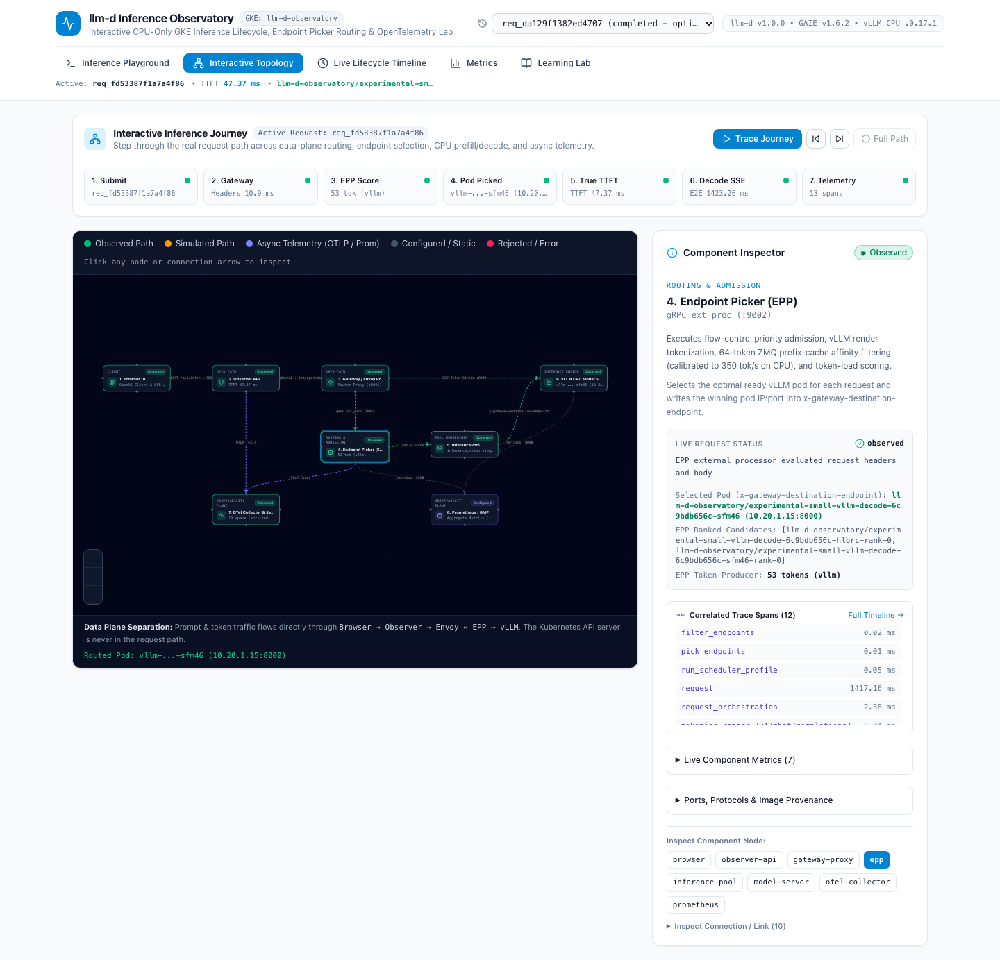
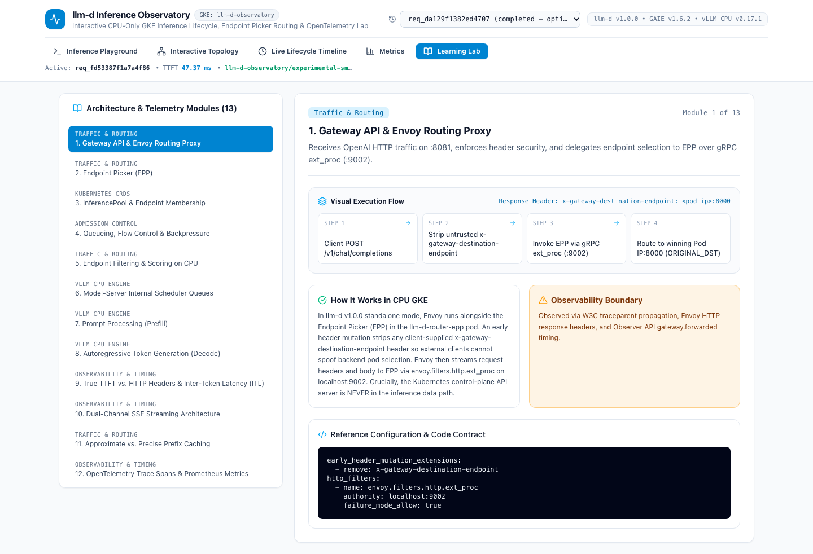

# Interactive Topology & Learning Lab Guide

This guide explains how to explore the **Interactive Topology** canvas, step through a live or simulated inference request, inspect nodes and connections, and run practical experiments in `llm-d-inference-observatory`.

---

## 1. Exploring the Interactive Topology (`ScreenTopology.tsx`)

The **Interactive Topology** screen models the exact `llm-d` inference architecture across two distinct planes:

1. **Dominant Inference Data Path (Solid Directional Edges):**
   - `1. Browser UI` → `2. Observer API (:8080)` → `3. Gateway / Envoy Proxy (:8081)` ↔ `4. Endpoint Picker (EPP :9002)` → `5. InferencePool` → `6. vLLM CPU Model Server (:8000)` → `Streaming SSE Response`.
2. **Secondary Async Telemetry Path (Dashed Directional Edges):**
   - `Observer API` & `EPP` → `7. OTel Collector & Jaeger (:4317 / :16686)` (out-of-band OTLP trace spans).
   - `EPP (:9090/metrics)` & `vLLM (:8000/metrics)` → `8. Prometheus / GMP` (aggregate gauge and counter scraping).

### 1.1 Step-by-Step Request Journey Playback
At the top of the Interactive Topology screen, the **Interactive Inference Journey** bar breaks any selected request into 7 ordered stages:
1. **1. Submit (`request.accepted`):** Browser sends the OpenAI request; Observer API assigns `request_id` and starts a W3C `traceparent`.
2. **2. Gateway (`gateway.forwarded`):** Observer API forwards the request to Envoy (`:8081`), which strips untrusted `x-gateway-destination-endpoint` headers and calls EPP `ext_proc` (`:9002`).
3. **3. EPP Score (`routing.started`):** EPP checks priority-band admission, tokenizes the prompt via vLLM's `/v1/chat/completions/render` endpoint, checks 64-token KV prefix blocks, and scores candidate pods.
4. **4. Pod Picked (`endpoint.selected`):** EPP sets `x-gateway-destination-endpoint` to the winning vLLM pod IP:port; Envoy routes directly via `ORIGINAL_DST`.
5. **5. True TTFT (`model.first_token`):** The winning vLLM CPU pod completes prompt prefill and emits the first non-empty content delta (`True TTFT`).
6. **6. Decode SSE (`request.completed`):** vLLM streams autoregressive tokens back to the browser and emits final subword `usage` counts.
7. **7. Telemetry (`trace.enriched`):** Out-of-band OTLP spans flush to Jaeger and Prometheus scrapes aggregate gauges.

Use the playback controls (**`Trace Journey` / `Pause`**, **`Previous Step`**, **`Next Step`**, **`Full Path`**) or click any stage pill directly to highlight the active components and connections for that step.

### 1.2 Component Inspector vs. Connection Inspector
- **Inspecting a Node (Component Inspector):** Click any node on the canvas (or its quick-select button) to view:
  - Architectural role and CPU GKE runtime behavior.
  - Live request status (`Observed`, `Measured`, `Simulated`, `Skipped`, or `Error / Rejected`).
  - For **EPP**, **InferencePool**, and **vLLM Model Server**: the authoritative **`Selected Pod (x-gateway-destination-endpoint)`** alongside **`EPP Ranked Candidates`** (`pick_endpoints`) and **`EPP Token Producer`**.
  - **Correlated Trace Spans** recorded on that component for the active request.
  - Progressive `
` disclosures for **Live Component Metrics** and **Ports, Protocols & Image Provenance**.
- **Inspecting a Link (Connection Inspector):** Click any directional edge on the canvas (or expand **`Inspect Connection / Link (10)`**) to view:
  - Protocol and port (`HTTP/1.1 + SSE`, `Bidirectional gRPC ext_proc :9002`, `ZMQ + Headless DNS :8000`, `OTLP gRPC :4317`).
  - Headers and payload contract (`traceparent`, `x-llm-d-inference-objective`, `x-gateway-destination-endpoint`, `stream_options.include_usage`).
  - Resilience and failure semantics (`failureMode: FailOpen`, client `AbortController` propagation, RBAC Bearer token scraping).

---

## 2. Guided Practical Experiments

### Experiment 1 — Observing 64-Token KV Prefix-Cache Block Hits
**Goal:** Understand why short prompts (`< 64` tokens) produce `0` KV-cache index block hits while prompts `>= 64` tokens trigger ZMQ block lookups and cache hits.

1. Open **Inference Playground** (`http://localhost:5173` in local mode or `http://localhost:8088` on GKE).
2. Click the **`Prefix-Cache Routing (>=64-tok block)`** guided template button (which populates a prompt exceeding 64 subword tokens).
3. Click **`Send Prompt`** twice with the same prompt prefix.
4. Open **Interactive Topology** → click **`4. Endpoint Picker (EPP)`** → expand **`Live Component Metrics`**, or switch to **Metrics**:
   - Observe `llm_d_epp_kv_cache_index_lookup_hits_total` and `llm_d_epp_prefix_predicted_cached_tokens_sum` increment on the second request (`64` or `128` cached tokens).
   - Observe that EPP routes the second request to the same vLLM pod (`x-gateway-destination-endpoint`) that cached the 64-token prefix block.

### Experiment 2 — True TTFT vs. HTTP Response Headers Arrival
**Goal:** Verify why HTTP `200 OK` response header latency (`UpstreamHeadersMs`) is distinct from **True TTFT** (`TTFTMs`).

1. In **Inference Playground**, click the **`True TTFT vs Header Latency`** template and submit the request.
2. Switch to **Live Lifecycle Timeline**:
   - Compare `#5 model.request.started` (`UpstreamHeadersMs`, when HTTP `200` headers and the initial empty `{"role":"assistant","content":""}` chunk arrive) against `#6 model.first_token` (`True TTFT`, when the first non-empty generated text token arrives).
   - Notice that **Model-Server Prefill Span** is explicitly labeled **`Unavailable`** (`prefill_duration_ms: null`) rather than fabricated from TTFT.

### Experiment 3 — Flow Control Priority Queueing & Saturation Rejection (`HTTP 429`)
**Goal:** Observe how `llm-d` protects CPU model servers under overload.

- **In Local Mode (`OBSERVER_MOCK_MODE=true`):**
  1. Select **`Saturation / HTTP 429 Shedding`** in the `Simulated Scenario` dropdown and click **`Send Prompt`**.
  2. Switch to **Interactive Topology** and **Live Lifecycle Timeline** to observe `queue.observed` and `request.failed` (`x-llm-d-request-dropped-reason: rejected-saturated`).
- **On Live GKE (`ROUTER_MODE=flow-control`):**
  1. Send a concurrent burst (`concurrency=12`) via `cmd/benchmark`.
  2. Observe `llm_d_epp_flow_control_queue_size` peak at `8` and `llm_d_epp_flow_control_pool_saturation` reach `2.0` while `vllm:num_requests_running` stays capped at `4.0`.

### Experiment 4 — Reconciling Observer vs. EPP Request Counters & Token Provenance
**Goal:** Understand why different layers report different request or token counts when scopes or tokenizers differ.

1. Open **Metrics** and inspect the **`Request Counter Reconciliation (Observer vs. EPP)`** card:
   - Verify the live equation: `Completed + Routed Errors = EPP Routed` (`llm_d_epp_request_total`).
   - Pre-routing rejections (`HTTP 429` saturation or `HTTP 503` zero-endpoint unavailability) increment `observer_requests_rejected_prerouting_total` and `llm_d_epp_request_error_total`, but do **not** increment `llm_d_epp_request_total` because EPP only increments `request_total` when a request is scheduled to a backend pod.
2. Open **Live Lifecycle Timeline** and inspect the **`Token Count Provenance`** card:
   - Compare `Input: N tokens (source: vllm_usage)` against `EPP tokenize span: N tokens (backend: vllm)`. Both match (`53 tokens` / `60 tokens`) because Observer enables `stream_options.include_usage=true` and EPP's `token-producer` calls vLLM's `/v1/chat/completions/render` endpoint.

---

## 3. 13-Module Learning Lab Curriculum (`ScreenLearningLab.tsx`)

Each module in the **Learning Lab** screen includes a 4-step **Visual Execution Flow**, **Key Telemetry Signal**, **How It Works in CPU GKE**, **Observability Boundary**, and **Reference Configuration**:

1. **Gateway API & Envoy Routing Proxy** (`early_header_mutation`, `ext_proc`, `ORIGINAL_DST`).
2. **Endpoint Picker (EPP)** (`EndpointPickerConfig`, gRPC `:9002`, RBAC `:9090/metrics`).
3. **InferencePool & Endpoint Membership** (`inference.networking.k8s.io/v1` vs. `InferenceObjective`).
4. **Queueing, Flow Control & Backpressure** (Priority bands `100`, `0`, `-10` and `concurrency-detector`).
5. **Endpoint Filtering & Scoring on CPU** (`peakPrefillThroughput: 350` CPU calibration vs. `15928` GPU default).
6. **Model-Server Internal Scheduler Queues** (`vllm:num_requests_running` vs. `vllm:num_requests_waiting`).
7. **Prompt Processing (Prefill)** (Intel AMX `amx_bf16` compute phase and why prefill duration is `unavailable` without a model-server span).
8. **Autoregressive Token Generation (Decode)** (DDR5 memory-bandwidth bound token loop and ITL distribution).
9. **True TTFT vs. HTTP Headers & Inter-Token Latency (ITL)** (Ignoring empty role chunks; Mean/p95 ITL & Decode `tok/s` formulas).
10. **Dual-Channel SSE Streaming Architecture** (Streaming OpenAI tokens while emitting structured `EventEnvelope` items).
11. **Approximate vs. Precise Prefix Caching** (ZMQ `tcp://*:5556` KV block publishing, `blockSizeTokens: 64`, `xxh64`).
12. **OpenTelemetry Trace Spans & Prometheus Metrics** (`--tracing=true`, `OTEL_BSP_SCHEDULE_DELAY=200`, asynchronous Jaeger enrichment).
13. **CPU-Only GKE Capacity, Quotas & Cost Architecture** (`1x c3-standard-22` + `1x e2-standard-4`, Torch/OneDNN warmup, rolling update deadlock math).
